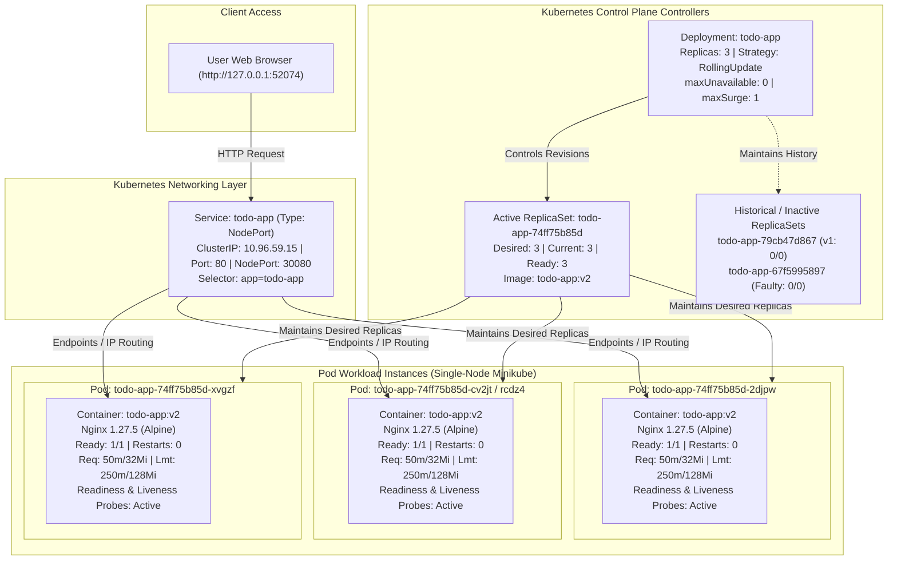

# Kubernetes Deployment with Monitoring for a To-Do App

A comprehensive course-end DevOps project demonstrating production-grade container orchestration, self-healing, high availability, zero-downtime rolling updates, automated fault isolation, rollbacks, and resource monitoring on a local Kubernetes cluster using Docker Desktop and Minikube on Windows.

---

## Table of Contents
1. [Project Title](#1-project-title)
2. [Abstract and Overview](#2-abstract-and-overview)
3. [Problem Statement](#3-problem-statement)
4. [Objectives](#4-objectives)
5. [Technology Stack](#5-technology-stack)
6. [System Architecture](#6-system-architecture)
7. [Architecture Diagram](#7-architecture-diagram)
8. [Project Directory Structure](#8-project-directory-structure)
9. [Kubernetes Component Explanation](#9-kubernetes-component-explanation)
10. [Setup Prerequisites](#10-setup-prerequisites)
11. [Installation and Execution Instructions](#11-installation-and-execution-instructions)
12. [Docker Image Build Instructions](#12-docker-image-build-instructions)
13. [Minikube Deployment Steps](#13-minikube-deployment-steps)
14. [Application Access Instructions](#14-application-access-instructions)
15. [Rolling Update Procedure (v1 to v2)](#15-rolling-update-procedure-v1-to-v2)
16. [Deliberately Failed Update Procedure](#16-deliberately-failed-update-procedure)
17. [Rollback Procedure](#17-rollback-procedure)
18. [Pod Deletion and Self-Healing Procedure](#18-pod-deletion-and-self-healing-procedure)
19. [Monitoring Commands](#19-monitoring-commands)
20. [Actual Experimental Results](#20-actual-experimental-results)
21. [Screenshot and Evidence References](#21-screenshot-and-evidence-references)
22. [Challenges and Troubleshooting](#22-challenges-and-troubleshooting)
23. [Conclusion](#23-conclusion)
24. [Future Enhancements](#24-future-enhancements)
25. [References](#25-references)

---

## 1. Project Title
**Kubernetes Deployment with Monitoring for a To-Do App**

---

## 2. Abstract and Overview
Modern microservice architectures demand continuous availability, fault resilience, and zero-downtime deployment pipelines. Deploying single application containers presents severe availability bottlenecks, as any process crash, underlying host degradation, or routine version update causes immediate service outages. 

This project implements and evaluates an end-to-end resilient deployment of a lightweight, responsive "Team To-Do" web application on Kubernetes using Minikube on Windows 10 Pro. The deployment orchestrates three container replicas managed by a Kubernetes Deployment and exposed via a `NodePort` Service. Through systematic experiments, the workload is tested against:
- Phased zero-downtime rolling updates (`v1` to `v2`) governed by `maxUnavailable: 0` and `maxSurge: 1`.
- Autonomous fault isolation during a deliberately invalid image update (`todo-app:does-not-exist`), validating that traffic-serving pods are shielded from failure.
- Rollback execution using `kubectl rollout undo` to swiftly recover from release faults.
- Autonomous self-healing upon pod deletion, restoring desired state within 9 seconds.
- Operational monitoring using `kubectl top pods`, Nginx container access logs, probe polling, and cluster-wide event auditing.

---

## 3. Problem Statement
Running standalone containerized web applications directly on container runtimes (such as plain Docker) exposes production workloads to single-point-of-failure (SPOF) risks:
1. **Downtime During Updates**: Replacing an active container requires stopping or destroying the running instance, resulting in connection drops and visible downtime for end users.
2. **Absence of Autonomous Healing**: If an application process crashes or memory leaks trigger an Out-Of-Memory (OOM) kill, manual operator intervention is required to restart or recreate the container.
3. **No Dynamic Traffic Routing**: Without an orchestration-aware load balancer, incoming requests cannot dynamically bypass unready or degraded instances.
4. **Lack of Controlled Rollback**: Reverting a faulty image deployment requires manual image re-tagging or redeploying previous configurations, increasing Mean Time to Recovery (MTTR).

To resolve these challenges, a declarative container orchestration system (Kubernetes) is needed to maintain replica availability, automate continuous health checking, orchestrate progressive releases, and autonomously reconcile runtime drift.

---

## 4. Objectives
- **Declarative Orchestration**: Package and deploy a containerized To-Do web application with three replicas and a Kubernetes `NodePort` Service.
- **Zero-Downtime Rollout**: Execute a phased rolling update from version `v1` to `v2` ensuring zero user-facing downtime.
- **Fault Containment Testing**: Trigger a deliberately faulty image deployment (`todo-app:does-not-exist`) and verify that Kubernetes prevents cascading outages by keeping healthy pods active.
- **Rapid Rollback**: Execute an immediate rollback to the preceding stable revision using `kubectl rollout undo` and verify ReplicaSet state convergence.
- **Self-Healing Verification**: Test automated pod reconciliation by forcefully deleting an active pod and measuring the recovery time until the replacement pod reaches `Ready` state.
- **Telemetry and Health Probing**: Implement container readiness and liveness HTTP probes, collect pod CPU and memory utilization with `metrics-server`, and analyze container startup logs and cluster event trails.
- **DevOps Best-Practice Evaluation**: Conduct an objective evaluation and generate a DevOps scorecard assessing automation, health checking, monitoring, rollback, and version control.

---

## 5. Technology Stack
- **Operating System**: Microsoft Windows 10 Pro (x86_64, Build 10.0.19045, 8 GB RAM, Intel Core i5-8350U CPU @ 1.70 GHz)
- **Shell / Automation**: Windows PowerShell 5.1
- **Container Runtime**: Docker Desktop 4.83.0 / Docker Engine v29.6.2 (API v1.55, containerd v2.2.5, runc v1.3.6)
- **Local Kubernetes Platform**: Minikube v1.39.0 (Kubernetes control plane v1.37.0, driver: docker)
- **Kubernetes CLI**: kubectl Client v1.36.1, Kustomize v5.8.1
- **Base Container Image**: `nginx:1.27-alpine`
- **Application Workload**: HTML5 / CSS3 / Vanilla JavaScript responsive single-page To-Do application
- **Cluster Addons**: `metrics-server` (enabled for resource metrics querying via `kubectl top`)

---

## 6. System Architecture
The application system is structured across four primary Kubernetes layers:

1. **Client Tier**: Web browsers access the To-Do application via a dedicated Minikube service port (`http://127.0.0.1:52074`), dynamically mapped to the cluster's NodePort endpoint.
2. **Service & Networking Tier**: The Kubernetes Service (`todo-app`, type `NodePort`) exposes port `80` internally and port `30080` across cluster nodes. Using label selector `app=todo-app`, the Service automatically discovers and round-robin load-balances HTTP traffic across all pods reporting `Ready: True`.
3. **Controller & Management Tier**: 
   - A **Deployment** controller (`todo-app`) declaratively governs the desired state (3 replicas), release strategy (`RollingUpdate` with `maxUnavailable: 0` and `maxSurge: 1`), and pod templates.
   - Distinct **ReplicaSets** manage immutable pod revisions: Revision 1 (`todo-app-79cb47d867`), Revision 2 & 4 (`todo-app-74ff75b85d`), and Revision 3 (`todo-app-67f5995897`).
4. **Workload & Container Tier**: Three identical pods run on the Minikube worker node. Each pod hosts an Nginx 1.27.5 container configured with resource constraints (Requests: 50m CPU / 32Mi RAM; Limits: 250m CPU / 128Mi RAM) and continuous HTTP readiness (`/`, initial delay 2s) and liveness (`/`, initial delay 5s) probes.

---

## 7. Architecture Diagram



---

## 8. Project Directory Structure

```plaintext
TodoList_devops_project/
├── app/
│   └── index.html                     # Application UI source code with VERSION_PLACEHOLDER
├── evidence/
│   ├── evidence-inventory.md          # Comprehensive evidence catalog and extraction audit
│   ├── S1-Cluster.jpg                 # Screenshot 1: Minikube status and node Ready state
│   ├── S2-Create_Deployment&services.jpg # Screenshot 2: Initial apply, rollout status, pods, services
│   ├── S3-Todo_application.jpg        # Screenshot 3: Browser UI showing deployment version v1
│   ├── S4-rollout.jpg                 # Screenshot 4: Rolling update execution (v1 to v2), RS scaling
│   ├── S5-Todo_application_v2.jpg     # Screenshot 5: Browser UI showing deployment version v2
│   ├── S6-failed_pods(L4 analysis).jpg# Screenshot 6: Deliberate failure, ImagePullBackOff, pod describe
│   ├── S7-rollback.jpg                # Screenshot 7: Rollback execution, status, and ReplicaSet state
│   ├── S8-selfhealing.jpg             # Screenshot 8: Pod deletion and autonomous 9-second recovery
│   ├── S9-Cpu_restarts.jpg            # Screenshot 9: kubectl top pods (CPU/RAM metrics) and restarts
│   ├── S10-application_logs.jpg       # Screenshot 10: Nginx startup logs and kube-probe HTTP access log
│   ├── S11-events.jpg                 # Screenshot 11: Cluster event trail sorted by timestamp
│   └── S12-deployment_description.jpg # Screenshot 12: kubectl describe deployment full metadata
├── k8s/
│   ├── deployment.yaml                # Declarative Deployment manifest (3 replicas, probes, resources)
│   └── service.yaml                   # Declarative NodePort Service manifest (port 80 -> nodePort 30080)
├── commands-windows.ps1               # Automated PowerShell execution and benchmarking script
├── Dockerfile                         # Multi-version Alpine Nginx container build specification
├── README.md                          # Project documentation and engineering guide
└── report-draft.docx                  # Formal academic course-end project report
```

---

## 9. Kubernetes Component Explanation

### Deployment (`k8s/deployment.yaml`)
A Deployment provides declarative updates for Pods and ReplicaSets. In this project:
- Declares `replicas: 3` under label selector `app: todo-app`.
- Configures `strategy.type: RollingUpdate` with `maxUnavailable: 0` (zero pods dropped during update) and `maxSurge: 1` (at most 1 additional pod created during update).
- Embeds container specifications including `imagePullPolicy: IfNotPresent`, container port 80, CPU/memory constraints, and health probes.

### ReplicaSet
The ReplicaSet controller ensures that a specified number of pod replicas are running at any given time.
- Each time the Deployment template changes (e.g., image change), the Deployment controller creates a new ReplicaSet identified by a unique `pod-template-hash` (e.g., `79cb47d867` for v1, `74ff75b85d` for v2, `67f5995897` for invalid image).
- When a pod dies or is deleted, the ReplicaSet immediately detects that `current < desired` and issues an API request to schedule a replacement pod.

### Pod
The smallest execution unit in Kubernetes. Each pod encapsulates:
- A single Nginx 1.27.5 container hosting the To-Do application.
- An individual cluster-private IP address (e.g., `10.244.0.10`).
- Resource limits enforcing cgroups constraints (max 250m CPU, 128Mi RAM).

### Service (`k8s/service.yaml`)
An abstraction defining a logical set of Pods and access policies:
- Configured with `type: NodePort`.
- Maps external traffic arriving on static port `30080` to container port `80` across all pods matching selector `app: todo-app`.
- Continuously polls pod readiness status, instantly removing unhealthy or unready pods from the active endpoints list.

### Readiness and Liveness Probes
- **Readiness Probe**: HTTP GET on `/` every 5 seconds (initial delay: 2s, timeout: 2s). Ensures the container is fully initialized before routing external traffic to it. During rolling updates, old pods are not terminated until the new pod's readiness probe succeeds.
- **Liveness Probe**: HTTP GET on `/` every 10 seconds (initial delay: 5s, timeout: 2s). Detects deadlocks or hung processes; if 3 consecutive failures occur, the kubelet kills and restarts the container.

---

## 10. Setup Prerequisites
Ensure the following software packages are installed and accessible on Windows:
1. **Docker Desktop for Windows**: Version 4.x or higher with WSL2 backend enabled.
2. **Minikube**: Version 1.30+ installed via Windows Package Manager (`winget install Kubernetes.minikube`) or Chocolatey.
3. **kubectl CLI**: Version 1.28+ (`winget install Kubernetes.kubectl`).
4. **PowerShell**: Windows PowerShell 5.1 or PowerShell Core 7+.

Verify installed tools before executing commands:
```powershell
docker --version
minikube version
kubectl version --client
```

---

## 11. Installation and Execution Instructions
All commands must be executed from the project root directory in Windows PowerShell:

```powershell
# Navigate to project workspace
cd C:\Users\LENOVO\OneDrive\Documents\TodoList_devops_project

# Ensure Docker Desktop is active, then launch Minikube
minikube start --driver=docker

# Enable the metrics-server addon for resource telemetry
minikube addons enable metrics-server

# Verify cluster connection
kubectl config current-context
kubectl get nodes
```

---

## 12. Docker Image Build Instructions
The application images are built directly into Minikube's internal Docker registry using Minikube's built-in image builder:

```powershell
# Build application version 1
minikube image build -t todo-app:v1 --build-arg APP_VERSION=v1 -f Dockerfile .

# Build application version 2
minikube image build -t todo-app:v2 --build-arg APP_VERSION=v2 -f Dockerfile .

# Confirm images exist in Minikube's local cache
minikube image ls | Select-String "todo-app"
```

---

## 13. Minikube Deployment Steps
Deploy the application and service manifests declaratively:

```powershell
# Apply Kubernetes Deployment and Service manifests
kubectl apply -f k8s/deployment.yaml
kubectl apply -f k8s/service.yaml

# Wait for the Deployment rollout to complete
kubectl rollout status deployment/todo-app --timeout=120s

# Inspect created resources
kubectl get deployments,replicasets,pods,services -o wide
```

---

## 14. Application Access Instructions
Because Docker on Windows operates within a virtualization boundary (WSL2), NodePort ports are not directly bound to localhost. Access the service using Minikube's URL generator:

```powershell
# Retrieve access URL
minikube service todo-app --url
```
Example output: `http://127.0.0.1:52074`  
Open the URL in any web browser to interact with the To-Do application. Verify that the header displays `Deployment version: v1`.

---

## 15. Rolling Update Procedure (v1 to v2)
Execute a phased, zero-downtime rolling update to version `v2`:

```powershell
# Trigger image update to v2
kubectl set image deployment/todo-app todo-app=todo-app:v2

# Track rollout progress in real time
kubectl rollout status deployment/todo-app --timeout=120s

# Verify rollout history and active ReplicaSets
kubectl rollout history deployment/todo-app
kubectl get rs,pods -o wide
```
Refresh the browser at `http://127.0.0.1:52074`. The header will dynamically transition to `Deployment version: v2` with zero request drops.

---

## 16. Deliberately Failed Update Procedure
Test Kubernetes fault isolation by updating the deployment to a non-existent container image tag:

```powershell
# Attempt update with an invalid image tag
kubectl set image deployment/todo-app todo-app=todo-app:does-not-exist

# Allow time for Kubernetes to attempt pod pull
Start-Sleep -Seconds 15

# Inspect pod statuses and failing conditions
kubectl get pods
kubectl describe pod -l app=todo-app
kubectl get events --sort-by=.metadata.creationTimestamp
```
**Observation**: 
- A single surge pod enters `ErrImagePull` / `ImagePullBackOff`.
- Because `maxUnavailable: 0` is set and the new pod never achieves `Ready` status, Kubernetes keeps all three healthy `v2` pods serving traffic. 
- Application availability remains 100%.

---

## 17. Rollback Procedure
Revert the failed revision back to the last known healthy deployment revision:

```powershell
# Undo the failed deployment
kubectl rollout undo deployment/todo-app

# Monitor rollback status
kubectl rollout status deployment/todo-app --timeout=120s

# Verify ReplicaSet reconciliation
kubectl get deployment,rs,pods -o wide
kubectl rollout history deployment/todo-app
```
**Observation**: 
- Kubernetes scales down the failed ReplicaSet (`todo-app-67f5995897`) to 0 and terminates the failing pod.
- Traffic continues uninterrupted on the stable `v2` ReplicaSet (`todo-app-74ff75b85d`).

---

## 18. Pod Deletion and Self-Healing Procedure
Demonstrate automated recovery against unexpected pod termination:

```powershell
# Identify and delete an active pod
$targetPod = kubectl get pods -l app=todo-app -o jsonpath="{.items[0].metadata.name}"
Write-Output "Deleting pod: $targetPod"
kubectl delete pod $targetPod

# Watch reconciliation and replacement creation
kubectl get pods -w
```
**Observation**: 
- The ReplicaSet immediately detects a deficit (`2 < 3`).
- A new pod (`todo-app-74ff75b85d-rcdz4`) is scheduled, created, and transitions to `1/1 Running` within **9 seconds** (evidenced in screenshot `S8-selfhealing.jpg`).

---

## 19. Monitoring Commands
Execute cluster telemetry and health inspection commands:

```powershell
# Query real-time CPU and Memory utilization per pod
kubectl top pods

# Query node-level resource utilization
kubectl top nodes

# Query pod restart counts
kubectl get pods -o custom-columns="NAME:.metadata.name,STATUS:.status.phase,RESTARTS:.status.containerStatuses[0].restartCount"

# Stream application container logs (replace with active pod name)
kubectl logs -l app=todo-app -c todo-app --tail=50

# Inspect cluster lifecycle events chronologically
kubectl get events --sort-by=.metadata.creationTimestamp

# Inspect comprehensive deployment configuration
kubectl describe deployment todo-app
```

---

## 20. Actual Experimental Results

| Test Case | Expected Result | Actual Observed Result | Pass / Fail | Evidence Reference |
|---|---|---|---|---|
| **Normal Deployment** | 3 pods Ready, NodePort Service created and reachable in browser | 3 pods (`79cb47d867-*`) Ready (1/1 Running, 0 restarts, age 74s–75s). Service active on port 30080 (ClusterIP: `10.96.59.15`). Browser reached at `http://127.0.0.1:52074` displaying `v1`. | **PASS** | `S1-Cluster.jpg`, `S2-Create_Deployment&services.jpg`, `S3-Todo_application.jpg` |
| **Rolling Update (v1→v2)** | Incremental pod surge and replacement; zero downtime; browser displays `v2` | Phased rollout completed. New RS `74ff75b85d` scaled to 3; old RS `79cb47d867` scaled to 0. 3 new pods 1/1 Running. Browser displays `Deployment version: v2`. | **PASS** | `S4-rollout.jpg`, `S5-Todo_application_v2.jpg` |
| **Failed Image Update** | Faulty pod fails to pull; existing pods continue serving traffic uninterrupted | New pod `67f5995897-ssd77` entered `ErrImagePull` / `ImagePullBackOff`. All 3 old `v2` pods remained 1/1 Running. App remained fully accessible. | **PASS** | `S6-failed_pods(L4 analysis).jpg` |
| **Rollback Operation** | Rollout undone; failing pod terminated; stable revision preserved | `kubectl rollout undo` reverted deployment. RS `67f5995897` scaled to 0; RS `74ff75b85d` maintained 3/3 ready pods. Status reported success. | **PASS** | `S7-rollback.jpg` |
| **Pod Deletion & Recovery** | Deleted pod immediately replaced; replica count restored to 3 | Pod `cv2jt` deleted. RS created replacement pod `rcdz4`, which reached `1/1 Running` and passed readiness in **9 seconds**. | **PASS** | `S8-selfhealing.jpg` |
| **Resource Telemetry** | Metrics reported for all active pods; restarts remain zero | `kubectl top pods` confirmed 1m CPU / 7Mi RAM per pod (Total: 3m CPU, 21Mi RAM). Restart count remained **0** across all pods. | **PASS** | `S9-Cpu_restarts.jpg`, `S10-application_logs.jpg` |

---

## 21. Screenshot and Evidence References
All supporting evidence is stored in the project's `evidence/` directory:

- **`S1-Cluster.jpg`**: Minikube status showing Control Plane, host, kubelet, and apiserver running; node status `Ready` on Kubernetes `v1.37.0`.
- **`S2-Create_Deployment&services.jpg`**: Execution of `kubectl apply`, `rollout status`, initial 3 pods, Deployment state (3/3 Ready), and NodePort Service.
- **`S3-Todo_application.jpg`**: Browser verification of the To-Do application running `Deployment version: v1` with interactive tasks.
- **`S4-rollout.jpg`**: Rolling update output, phased rollout progress, pods in new ReplicaSet `74ff75b85d`, and rollout history.
- **`S5-Todo_application_v2.jpg`**: Browser verification showing live application running `Deployment version: v2`.
- **`S6-failed_pods(L4 analysis).jpg`**: Pod status showing surge pod `todo-app-67f5995897-ssd77` in `ErrImagePull`, and pod describe output showing `ImagePullBackOff` while 3 existing v2 pods remain healthy.
- **`S7-rollback.jpg`**: Execution of `kubectl rollout undo`, termination of faulty pod, and ReplicaSet state showing `67f5995897` at 0 and `74ff75b85d` at 3.
- **`S8-selfhealing.jpg`**: Pod deletion command and `kubectl get pods -w` showing replacement pod `rcdz4` running at age 9 seconds.
- **`S9-Cpu_restarts.jpg`**: Metrics monitoring via `kubectl top pods` (1m CPU, 7Mi RAM) and custom-columns output confirming 0 restarts.
- **`S10-application_logs.jpg`**: Container logs showing Nginx 1.27.5 startup and periodic HTTP 200 health probe requests from `kube-probe/1.37`.
- **`S11-events.jpg`**: Chronological Kubernetes events trail recording node readiness, replica scaling, scheduling, image pulling, and container start.
- **`S12-deployment_description.jpg`**: Comprehensive `kubectl describe deployment todo-app` output detailing Revision 4, probe parameters, resource limits, and ReplicaSet conditions.

---

## 22. Challenges and Troubleshooting

### 1. Windows NodePort Accessibility via Minikube
- **Challenge**: Navigating to `http://localhost:30080` in a Windows web browser fails because Minikube runs inside a Docker VM/WSL2 network namespace that does not directly expose Linux host ports to Windows localhost.
- **Root Cause**: Docker driver networking isolation on Windows.
- **Solution**: Run `minikube service todo-app --url` to obtain an assigned local proxy tunnel endpoint (`http://127.0.0.1:52074`), or run `minikube tunnel` in an administrative shell.

### 2. Metric Telemetry Unavailability (`kubectl top pods`)
- **Challenge**: Executing `kubectl top pods` initially returned `error: Metrics API not available`.
- **Root Cause**: The `metrics-server` pod is not enabled by default in base Minikube profiles.
- **Solution**: Execute `minikube addons enable metrics-server`, then wait 60–90 seconds for the metrics aggregator to scrape kubelet summary endpoints before querying.

### 3. Annotations Warning During Rollback
- **Challenge**: Executing `kubectl rollout undo` displayed a warning: `resource deployments/todo-app was previously managed with 'kubectl apply'...`.
- **Root Cause**: `kubectl apply` tracks state using `kubectl.kubernetes.io/last-applied-configuration`, whereas imperative `rollout undo` modifies the live spec directly.
- **Solution**: In production declarative pipelines, version changes should be managed by reapplying Git-versioned manifest commits rather than imperative commands.

---

## 23. Conclusion
The implementation successfully demonstrated the core tenets of cloud-native resilience:
1. **High Availability**: Decoupling the workload across 3 pod replicas behind a NodePort Service eliminated single points of failure.
2. **Deterministic Upgrades**: Setting `maxUnavailable: 0` guaranteed that old pods were never terminated before replacement pods successfully passed readiness checks.
3. **Automated Self-Healing**: The ReplicaSet reconciliation loop restored desired pod counts within 9 seconds without human intervention.
4. **Resilience to Deployment Faults**: An invalid image tag was automatically contained, preventing outages and allowing instantaneous rollback via `kubectl rollout undo`.

---

## 24. Future Enhancements
1. **Horizontal Pod Autoscaling (HPA)**: Integrate an HPA resource to dynamically scale replicas between 2 and 10 based on CPU threshold (e.g., 70%) and request rate metrics.
2. **GitOps & Automated CI/CD**: Implement a GitHub Actions pipeline integrated with ArgoCD to automatically test, build, scan with Trivy, and declaratively deploy commits to Kubernetes.
3. **Enterprise Monitoring Stack**: Deploy Prometheus and Grafana with pre-configured alerting rules for pod restarts, probe failures, and latency spikes.

---

## 25. References
- Kubernetes Documentation — Deployments: [https://kubernetes.io/docs/concepts/workloads/controllers/deployment/](https://kubernetes.io/docs/concepts/workloads/controllers/deployment/)
- Kubernetes Documentation — Services: [https://kubernetes.io/docs/concepts/services-networking/service/](https://kubernetes.io/docs/concepts/services-networking/service/)
- Kubernetes Documentation — Pod Lifecycle & Probes: [https://kubernetes.io/docs/concepts/workloads/pods/pod-lifecycle/](https://kubernetes.io/docs/concepts/workloads/pods/pod-lifecycle/)
- Kubernetes Documentation — kubectl rollout: [https://kubernetes.io/docs/reference/kubectl/generated/kubectl_rollout/](https://kubernetes.io/docs/reference/kubectl/generated/kubectl_rollout/)
- Minikube Official Documentation: [https://minikube.sigs.k8s.io/docs/](https://minikube.sigs.k8s.io/docs/)
- Docker Desktop Documentation: [https://docs.docker.com/desktop/](https://docs.docker.com/desktop/)
